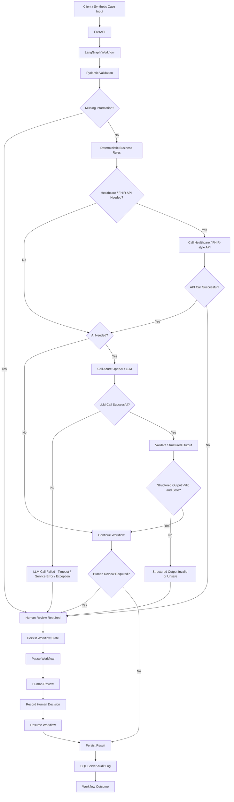
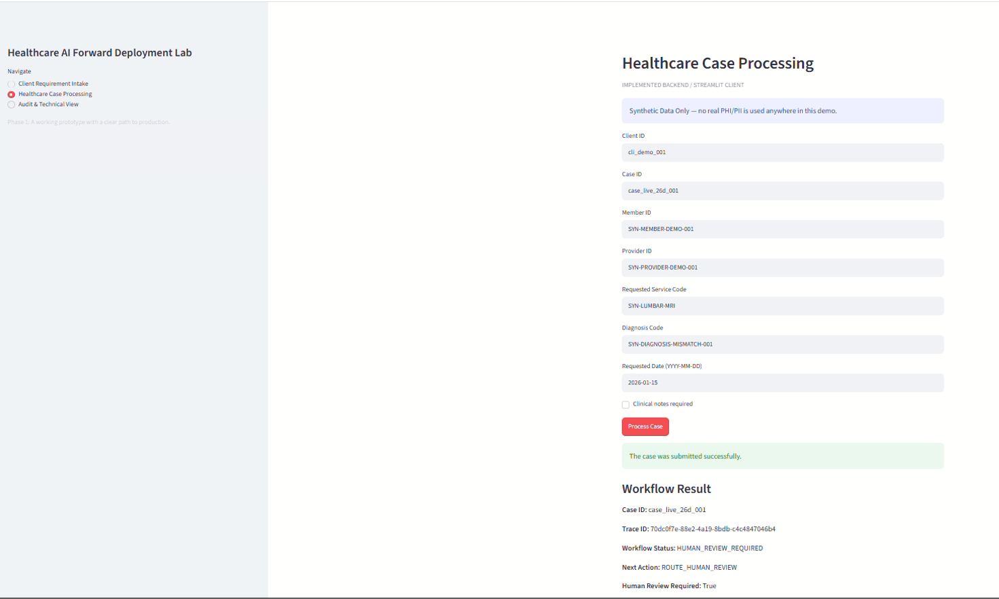
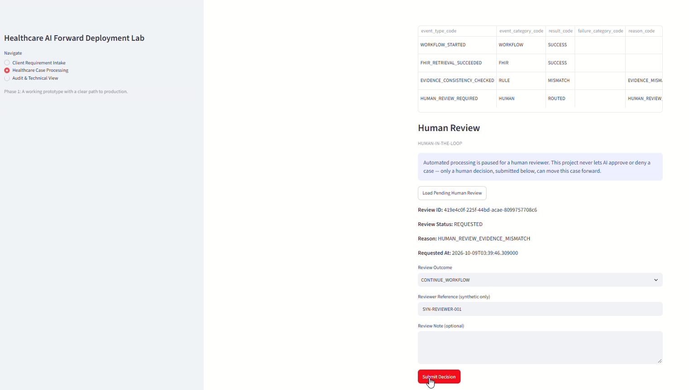
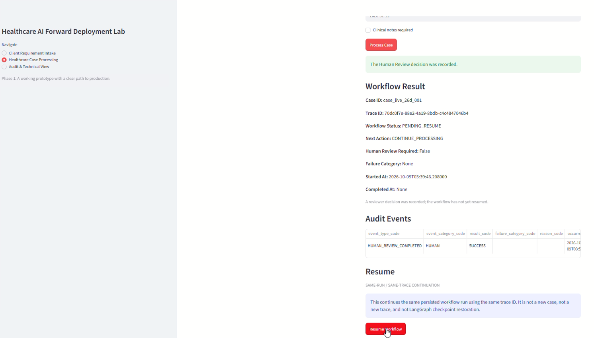
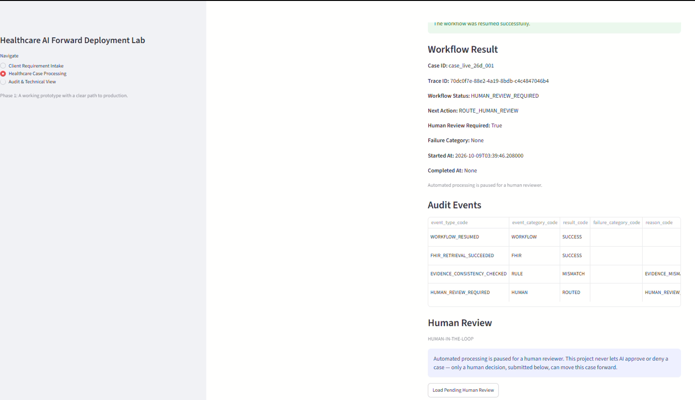
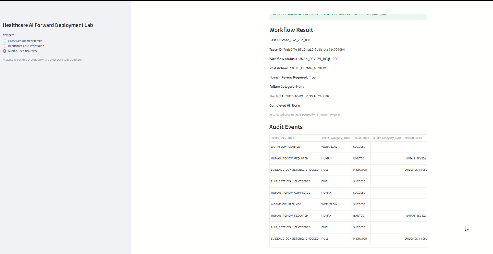
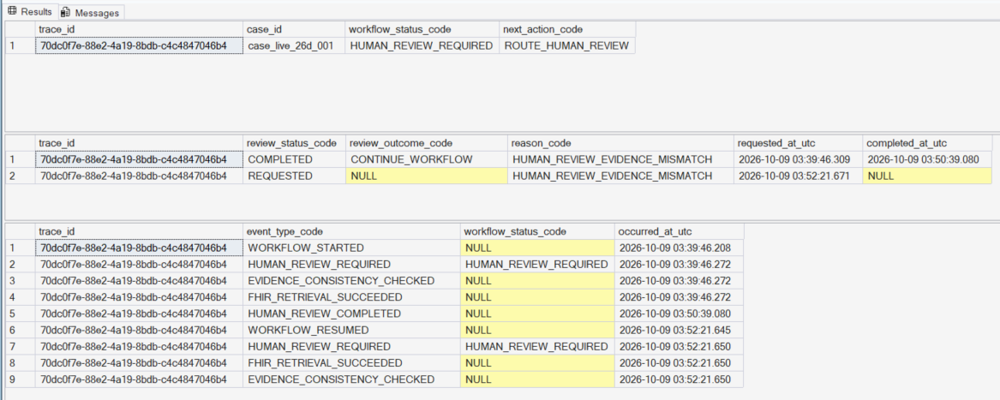

<!--
File Name: README.md
Purpose: Main project overview, Phase 1 scope, architecture summary, current status, setup guidance, limitations, and production roadmap.
Creation Date: 2026-09-13
Author: K.Kashiwagi
-->

# Healthcare AI Forward Deployment Lab

## 1. Purpose

This project demonstrates the end-to-end skill set of a healthcare Data
Forward Deployment Engineer (FDE): translating a business problem into
requirements, designing a solution architecture, implementing it, and
planning its path from prototype to production — applied to a
healthcare workflow support use case.

## 2. FDE Portfolio Objective

This project is intentionally built to demonstrate:

- Requirements gathering and translation
- Solution architecture
- Python development
- REST/API integration
- Healthcare/FHIR-style integration
- LLM workflows
- SQL
- Testing
- Human-in-the-loop review
- Auditability
- Documentation
- Client delivery thinking
- Prototype-to-production planning

## 3. Phase 1 Use Case

**Prior Authorization workflow support.** A synthetic prior
authorization case is validated, run through explicit business rules,
optionally assisted by an LLM for language-oriented sub-tasks, and
routed to human review when information is missing, uncertain, or
high-impact. See [docs/requirements.md](docs/requirements.md) for full
detail.

**This is not intended to be a production healthcare system.** Only
synthetic healthcare data is used. The AI does not independently make
clinical approval or denial decisions — see
[docs/security.md](docs/security.md).

## 4. Current Project Status

**IMPLEMENTED:**
- Pydantic prior-authorization case validation
- Deterministic completeness rules
- FastAPI case-validation endpoint (`POST /cases/validate`)
- LangGraph workflow foundation (explicit graph, nodes, and routing)
- Deterministic AI-routing rules
- Structured AI contract and provider flow (validated structured
  output, never a raw/untrusted LLM response)
- Azure OpenAI adapter and configuration
- Synthetic FHIR-style integration client
- Deterministic evidence-consistency rules
- SQL persistence and audit foundation (`workflow_runs`, `audit_events`
  tables via a repository pattern)
- Local Microsoft SQL Server persistence validation (connectivity,
  schema creation, and repository read/write round-trips against a
  real local instance)
- Alembic migration framework, operational and applied: Wave 1
  (14 organization/reference tables) and Wave 2 (8 case/workflow
  tables, including a canonical replacement of the `workflow_runs`/
  `audit_events` prototype) of the canonical database foundation have
  both been migrated onto the real local SQL Server database and
  validated (installed revision `b9aba5b07ac8`); the disposable
  synthetic prototype rows were intentionally removed as part of the
  Wave 2 controlled rebuild, and all 14 Wave 1 tables were preserved
  unchanged
- LangGraph ↔ SQL persistence orchestration boundary (pure Python,
  `src/workflow/orchestrator.py`): generates one application-side
  UUID4 `trace_id` per workflow run, invokes the existing LangGraph
  graph, and persists the run to canonical `workflow_runs` (create at
  start, update on completion, immutable run-identity fields enforced)
  and canonical `audit_events` (meaningful transitions only, using the
  explicit stable LangGraph-node → `step_code` mapping in
  `src/workflow/step_mapping.py` — never a raw Python function name).
  `HUMAN_REVIEW_REQUIRED` is persisted as a pause, not a completion;
  persistence failures are surfaced, never hidden.
- Human-in-the-Loop decision persistence and same-run/same-trace
  resume (Tasks 23/24): a genuine `HUMAN_REVIEW_REQUIRED` disposition
  creates a real `human_reviews` row atomically with the same run's
  `workflow_runs`/`audit_events` writes. A human reviewer's
  `CONTINUE_WORKFLOW` decision (`POST /human-review/decisions`) moves
  the existing run to `PENDING_RESUME`/`CONTINUE_PROCESSING`.
  `resume_workflow()` (`src/workflow/resume_service.py`, exposed as
  `POST /workflows/{trace_id}/resume`) then validates eligibility and
  persisted case identity, atomically claims the SAME run (a race-safe
  conditional `UPDATE`, never read-then-write), and re-invokes the SAME
  LangGraph graph on the SAME `trace_id` with fresh caller-supplied
  input — application-level re-invocation, never LangGraph checkpoint
  restoration (no checkpointer exists in this project). A
  `WORKFLOW_RESUMED` audit event is recorded only when that automated
  continuation actually begins; `WORKFLOW_STARTED` is never re-emitted;
  a duplicate resume attempt is rejected safely. Validated both offline
  and directly against the real local SQL Server database.
- Stable Phase 1 reference/configuration data loader
  (`src/db/reference_data.py`), separate from Alembic schema
  migrations: idempotent insert-missing-only loading with conflict
  detection (a semantic mismatch fails and rolls back the whole load
  rather than silently overwriting). Loaded onto the real local SQL
  Server database and validated, including repeated second-run
  idempotency checks: **97 stable rows across 14 tables** (the original
  Task 22 baseline was 78 rows/12 tables; Task 23 added the
  `human_review_statuses`/`human_review_outcomes` domains and the six
  `CASE_CLOSE_*` reasons; Task 24 added `event_types.WORKFLOW_RESUMED`),
  including the complete approved 9-step `PRIOR_AUTHORIZATION` workflow
  definition/configuration.
- Real local SQL Server integration validation: the orchestration
  boundary end to end (a synthetic case, mocked FHIR success, the
  AI-not-needed path, reaching `COMPLETED`/`COMPLETE_WORKFLOW`); the
  Human Review decision-transition boundary (including an atomic
  rollback proof); and the full same-run/same-trace resume path
  (`HUMAN_REVIEW_REQUIRED` → real `human_reviews` row → `CONTINUE_WORKFLOW`
  → `PENDING_RESUME` → `resume_workflow()` → same `workflow_run`/same
  `trace_id` → `WORKFLOW_RESUMED` → `COMPLETED`, with a duplicate resume
  attempt safely rejected). All synthetic test fixtures are cleaned up
  afterward. No Azure OpenAI call and no real external FHIR call were
  made by any of these.
- Fresh-case workflow-start API (Task 25B): `POST /workflows`
  (`src/api/app.py`, `src/models/workflow_api.py`) starts a brand-new
  orchestration run for a fresh synthetic case through
  `src/workflow/case_intake_service.py`'s `start_new_case_workflow()` —
  the application generates `trace_id`; `client_id` must identify an
  existing, active, non-deleted client (no client auto-creation); the
  fresh case is persisted before the orchestrator runs; a race-safe
  conditional-`UPDATE` claim (reusing the existing, previously-unused
  `case_statuses.IN_PROGRESS` value) and a six-field duplicate/safe-retry
  identity check (including `client_id`) prevent two runs ever starting
  for the same case; a pre-first-write failure safely reverts the
  claim. **Case-status lifecycle correction (Task 25B-1/25B-2):**
  `case_status_code` now resolves correctly once a run leaves
  `IN_PROGRESS` — `OPEN` after ordinary automated completion or a
  persisted technical `FAILED` run (automation finishing or failing is
  never a business closure), `HUMAN_REVIEW_REQUIRED` while a run is
  genuinely paused for a reviewer, and `CLOSED` only via a genuine
  Human Review `CLOSE_CASE` decision — covering both a direct run and a
  same-run/same-trace resumed run. Returns HTTP 201 and never exposes
  raw `final_state`/FHIR/AI content or the internal conflict
  `reason_category`. **IMPLEMENTED AND VALIDATED — offline, and
  live-exercised against the real local SQL Server database
  (Task 26D)**.
- Synthetic FHIR runtime mode (Task 25C): `FHIR_MODE=synthetic`
  (`src/config/fhir_settings.py`) makes `get_fhir_client()`
  (`src/api/dependencies.py`) return a local, zero-network, synthetic-
  only `FHIRStyleClient` (`src/integrations/synthetic_fhir_runtime.py`,
  backed entirely by `httpx.MockTransport` — no socket/DNS/TLS access
  is possible) returning one deterministic synthetic evidence Bundle
  (`SYN-LUMBAR-MRI`/`SYN-LOW-BACK-PAIN`). `FHIR_MODE=disabled` (unset,
  blank, or any value other than `synthetic`/`live`) remains the
  default and still fails closed with the existing fixed 503;
  `FHIR_MODE=live` is explicitly **NOT IMPLEMENTED** and also fails
  closed — recognizing the word never builds a live/unauthenticated
  client. This is the one canonical dependency path both `POST
  /workflows` and `POST /workflows/{trace_id}/resume` already use, so
  both now run end to end locally under synthetic mode — the real path
  Task 26 Streamlit will use, not a test-only substitute. Phase 1
  local prototype/demo infrastructure only, never a production FHIR
  integration; supplies evidence only and makes no clinical approval/
  denial decision. **IMPLEMENTED AND VALIDATED — offline, and
  exercised in a real running local FastAPI process during Task 26D's
  live validation** (synthetic mode remains zero-network by
  construction — this is not a live-FHIR claim).
- Streamlit backend prework (Task 26B): two read-only HTTP endpoints —
  `GET /workflows/{trace_id}` and `GET /human-review/pending/{trace_id}`
  — let a future UI client re-fetch a run's durable state and discover
  a pending review's `review_id` using only the existing FastAPI
  boundary (no direct database/repository access). Both reuse existing
  repository read methods unchanged (`AuditRepository.get_workflow_run()`/
  `list_audit_events()`, `HumanReviewRepository.get_pending_review_by_trace_id()`)
  and perform no write of any kind. A new, explicit, operator-run local
  setup script (`scripts/setup_demo_client.py`) creates the one
  canonical synthetic demo client (`cli_demo_001`/`DEMO_HEALTH`/"Demo
  Health Plan") a local demo needs — idempotent and conflict-safe (an
  existing non-matching row is reported as a conflict, never
  overwritten), never run automatically by the application.
  **IMPLEMENTED AND VALIDATED — offline, and live-exercised against
  the real local SQL Server database (Task 26D)**: the setup script
  created the real canonical demo client (`INSERTED`, verified by
  read-only SQL), and both read-only endpoints were called live by
  Streamlit.
- Streamlit MVP foundation (Task 26C-1): `streamlit_app.py` — a thin
  HTTP/JSON client over FastAPI (`src/ui/api_client.py`, `httpx`) with
  three navigation areas (Client Requirement Intake, Healthcare Case
  Processing, Audit & Technical View). Client Requirement Intake is
  explicitly **MOCKED / UI-ONLY** (`st.session_state` only, never
  persisted, never sent to any backend). Healthcare Case Processing
  submits the canonical synthetic demo case
  (`src/ui/demo_data.py` — `client_id=cli_demo_001`,
  `requested_service_code=SYN-LUMBAR-MRI`,
  `diagnosis_code=SYN-LOW-BACK-PAIN`, matching the Task 25C synthetic
  FHIR evidence and the Task 26B demo client) through the real
  `POST /workflows`, with safe result/audit rendering
  (`src/ui/view_helpers.py` — an explicit field allowlist, never a raw
  `final_state`/FHIR/LLM field) and safe HTTP/connection/timeout error
  mapping — determined locally from the HTTP status code alone, never
  from the backend's own response body/`detail` text, so this boundary
  stays safe even if a future backend change put something unsafe
  there (Task 26C-1B); never a raw exception, response text, traceback,
  secret, connection string, or backend internal. Audit & Technical View shows
  only the latest response snapshot already held in session state —
  not a durable lookup. Streamlit never imports LangGraph, a workflow
  service, a repository, a SQLAlchemy session, a FHIR client, or the AI
  provider; every action goes through plain HTTP/JSON. **IMPLEMENTED
  AND VALIDATED — offline, and live-validated end-to-end against a
  real local FastAPI/SQL Server backend (Task 26D)**.
- Streamlit Human Review, Resume, and durable refresh (Task 26C-2):
  `src/ui/api_client.py` gained four thin methods —
  `get_workflow()`/`get_pending_human_review()` (`GET`, read-only) and
  `submit_human_review_decision()`/`resume_workflow()` (`POST`) — all
  sharing the same hardened, locally-controlled error mapping as
  `start_workflow()` (Task 26C-1B; backend response/`detail` text is
  never read). Inside Healthcare Case Processing: when the last known
  state is `HUMAN_REVIEW_REQUIRED`, an explicit "Load Pending Human
  Review" action discovers `review_id` via
  `GET /human-review/pending/{trace_id}` — **the operator never types a
  review_id manually**; the decision form then offers only the four
  real `HumanReviewOutcome` values (`CONTINUE_WORKFLOW`,
  `REQUEST_MORE_INFORMATION`, `ESCALATE`, `CLOSE_CASE` — copied
  verbatim from `src/models/human_review.py`; no approve/deny control
  exists or could exist), a fixed `reviewer_actor_type_code=
  HUMAN_REVIEWER` (the real, already-loaded `actor_types` value), and,
  only for `CLOSE_CASE`, one of the six real `CASE_CLOSE_*` reason
  codes (`CASE_CLOSE_OTHER` additionally requires explanatory text,
  mirroring the backend's own validation). When the resulting state is
  `PENDING_RESUME`, a Resume action rebuilds the request from the
  original `case`/`completeness_requirements`/`ai_processing_requirements`
  (no `client_id` — `ResumeWorkflowRequest` has none) and calls
  `POST /workflows/{trace_id}/resume`; a returned `trace_id` that does
  not match the one being continued is treated as unsafe and never
  applied. Audit & Technical View gained an explicit "Refresh Workflow
  State" action calling `GET /workflows/{trace_id}` — a **durable**
  backend re-fetch, not merely the last in-session response — never
  triggered automatically on rerender. **IMPLEMENTED AND VALIDATED —
  offline, and live-validated end-to-end (Task 26D)**: pending-review
  discovery, the `CONTINUE_WORKFLOW` decision, same-trace Resume, and
  durable refresh all succeeded live against real SQL Server.
- pytest test suite (650 tests passing, 4 opt-in real-SQL-Server tests
  intentionally skipped by default, as of this update)
- Architecture design artifacts (ADRs, architecture/security/
  requirements docs)

**DESIGNED / PLANNED (not yet implemented):**
- Remaining canonical Phase 1 relational data model (Wave 3 and later,
  14 of 36 tables remaining) — see [docs/database/](docs/database/)
- Wave 6 relational hardening (CHECK constraints, JSON validation,
  secondary indexes, composite FKs, `event_types` composite uniqueness,
  `workflow_runs` composite uniqueness)
- An approved, authenticated **live** production FHIR integration
  (`FHIR_MODE=live` remains explicitly not implemented and fails
  closed — see Current Limitations below)
- Stage 2 unresolved-missing-information escalation to Human Review
  (Stage 1's deterministic `REQUEST_MISSING_INFORMATION` routing is
  implemented)
- Reviewer assignment and a reviewer UI (reviewer identity is currently
  supplied directly by the caller — no authentication layer exists yet)
- Remaining end-to-end and productionization work — see
  [docs/production_roadmap.md](docs/production_roadmap.md)

## 5. Planned Phase 1 Stack

| Layer | Technology |
|-------|-----------|
| Frontend | Streamlit |
| Backend | Python, FastAPI, Pydantic |
| Workflow | LangGraph |
| Database | Microsoft SQL Server (local), SQL |
| AI | Azure OpenAI / Azure AI Foundry, structured LLM output |
| Integration | REST/JSON, healthcare/FHIR-style API |
| Testing | pytest |
| Development | Git, GitHub, Claude Code |

These choices (LangGraph, SQL Server, Azure OpenAI/Foundry) have been
reviewed and are fixed for Phase 1 — see
[docs/decisions/](docs/decisions/).

## 6. High-Level Architecture

The system separates three kinds of information at every stage of a
case: **deterministic facts/rules**, **AI inference**, and **human
decisions** — never blended together. Explicit validation and business
rules run before any LLM call; the LLM is used only for
language-oriented sub-tasks, never for the final outcome; and anything
missing, uncertain, or high-impact routes to human review. Full detail:
[docs/architecture.md](docs/architecture.md).

## 7. High-Level Workflow

## 8. Security & Privacy Statement

- Only **synthetic** healthcare data is used — no real PHI/PII, ever.
- No secrets, credentials, or connection strings are hard-coded;
  configuration is supplied via environment variables and git-ignored
  local files (see [.env.example](.env.example)).
- The AI does not independently make clinical approval or denial
  decisions — see [docs/security.md](docs/security.md) for full policy.

## 9. Prototype vs. Production

This is a **portfolio prototype**, not a production healthcare system.
It does not include production-grade authentication/authorization,
managed secrets, real FHIR server integration, formal compliance
controls, or operational hardening. See
[docs/production_roadmap.md](docs/production_roadmap.md) for what
Phase 2 (production) would require.

## 10. Current Limitations

- **FHIR integration boundary — IMPLEMENTED:** the FHIR-style client
  abstraction (`src/integrations/fhir_client.py`), the fail-closed
  FastAPI dependency boundary with its explicit `FHIR_MODE` runtime
  mode (`src/api/dependencies.py`'s `get_fhir_client()`,
  `src/config/fhir_settings.py`), the explicit local synthetic runtime
  (`src/integrations/synthetic_fhir_runtime.py`, Task 25C), and offline
  mocked FHIR test paths (`httpx.MockTransport`, never a live network
  call). **NOT YET IMPLEMENTED:** an approved, authenticated, live
  production FHIR integration — `FHIR_MODE=live` is recognized but
  always fails closed, exactly like the default. `FHIR_MODE=disabled`
  is the default for unset or blank `FHIR_MODE` and fails closed. An
  unrecognized `FHIR_MODE` value is rejected by configuration
  validation and is converted by `get_fhir_client()` to the same
  fail-closed `FHIRIntegrationNotConfiguredError` path — it is never
  normalized to `disabled`, and never treated as `synthetic` or
  `live`. Either way, a real HTTP request against any endpoint that
  depends on `get_fhir_client()` (the fresh-case workflow-start API and
  the Resume API) and does not explicitly set `FHIR_MODE=synthetic`
  always fails closed with a fixed HTTP 503 — see
  [docs/security.md](docs/security.md).
  Setting `FHIR_MODE=synthetic` (e.g. in a local `.env`) returns a
  working, zero-network, synthetic-only client for local prototype/
  demo use — Phase 1 local infrastructure only, never a production
  integration, and never a clinical decision-maker; it supplies one
  fixed, deterministic evidence Bundle for every case, so a demo case
  using different codes than the synthetic Bundle's own
  (`SYN-LUMBAR-MRI`/`SYN-LOW-BACK-PAIN`) correctly routes to Human
  Review via the existing, unmodified evidence-consistency check — not
  a defect. A test overriding this dependency with `httpx.MockTransport`
  remains a separate, test-only double, distinct from this runtime
  mode.
- Only 25 application tables (26 including `alembic_version`) of the
  canonical 36-table Phase 1 database design (see
  [docs/database/](docs/database/)) are physically built (Waves 1-2).
  The application now exposes six HTTP endpoints: `POST
  /cases/validate` (deterministic validation only, non-persistent, does
  not start a workflow), `POST /workflows` (Task 25B — starts a
  brand-new workflow run for a fresh/safely-retried case), `POST
  /human-review/decisions` (records a Human Review decision for an
  existing run), `POST /workflows/{trace_id}/resume` (same-run/
  same-trace continuation for an existing run), and two read-only
  lookups added for the upcoming Streamlit UI (Task 26B): `GET
  /workflows/{trace_id}` (re-fetches a run's current durable
  `workflow_run`/`audit_events` state) and `GET
  /human-review/pending/{trace_id}` (reports the pending Human Review,
  if any, for a trace_id — never a `COMPLETED`/`CANCELLED` one). Both
  GET endpoints are strictly read-only: they never mutate state, never
  create an audit event, and never call FHIR, AI, or LangGraph.
  **IMPLEMENTED AND VALIDATED — offline, and live-validated against
  real SQL Server (Task 26D)**.
- `POST /workflows`'s fresh-intake/resume callers do not currently
  supply `step_code_to_workflow_step_id` to the orchestrator, so some
  audit events for these paths can have `workflow_step_id = NULL` — the
  `workflow_definition_steps` catalog itself is loaded (9 rows; see
  [docs/database/reference_data.md](docs/database/reference_data.md)),
  this is a current Phase 1 audit-enrichment limitation, not missing
  reference data. `audit_events.workflow_step_id` is nullable.
- Human-review outcomes are persisted and same-run/same-trace resume
  is implemented (Tasks 23/24) — see Current Status above. Stage 2
  unresolved-missing-information escalation to Human Review remains
  not implemented. The external Stage 1 requester notification/
  response transport remains planned, not implemented.
- The Streamlit UI (Tasks 26C-1/26C-2) now covers the full backend-
  supported flow: the application shell, the mocked Requirement Intake
  page, the fresh-case `POST /workflows` flow, pending Human Review
  discovery and decision submission, same-run/same-trace Resume, and a
  durable `GET /workflows/{trace_id}` refresh — with safe result/audit
  rendering throughout. This is a working prototype UI with no login/
  RBAC, no dashboards/charts, and no production hardening — not a
  complete production application.
- **Task 26D (live local end-to-end validation): LIVE LOCAL
  VALIDATION COMPLETED.** A real local FastAPI process
  (`FHIR_MODE=synthetic`) and a real local Streamlit process were run
  together against the real local SQL Server database. The full flow
  — fresh case submission, deterministic diagnosis-mismatch routing to
  Human Review (no AI call), pending-review discovery, a
  `CONTINUE_WORKFLOW` decision, `PENDING_RESUME`, same-run/same-trace
  Resume (application-level re-invocation of the same compiled
  LangGraph graph on the same `trace_id` — never LangGraph checkpoint
  restoration; no checkpointer exists in this project),
  `WORKFLOW_RESUMED` persistence, the unchanged diagnosis mismatch
  being deterministically re-evaluated and correctly returning the
  resumed workflow to `HUMAN_REVIEW_REQUIRED`, and a durable `GET
  /workflows/{trace_id}` refresh — was exercised live and
  independently verified by direct, read-only SQL Server queries
  (case/workflow/human-review/audit persistence all confirmed). No
  live FHIR call and no live AI call occurred during this validation —
  `FHIR_MODE=synthetic` was used throughout (zero-network by
  construction), and the validated scenario required no AI step. This
  is **CONFIGURATION/PATH EVIDENCE**, not network-capture evidence (no
  packet/network capture was performed). This validates the local
  prototype flow only — it is not a production-readiness claim, not a
  live/production FHIR integration claim, not a live AI validation
  claim, and not an authentication/authorization claim; it does not
  change any NOT-IMPLEMENTED item elsewhere in this document.
- No production authentication/authorization layer exists yet —
  reviewer identity is supplied directly by the caller.
- Not evaluated for clinical, legal, or regulatory accuracy — it is a
  technical/architectural demonstration only.

## 11. Phase 2 — Productionization (Summary)

Moving toward production would require, among other things: real
PHI/HIPAA-compliant data handling, authentication/authorization, a
managed secrets vault, real FHIR/payer integrations, production
observability, and formal AI governance. See
[docs/production_roadmap.md](docs/production_roadmap.md) for the full
summary.

## 12. Database Design Documentation

**IMPLEMENTED:**
- The Alembic migration framework (see
  [ADR-005](docs/decisions/ADR-005-database-schema-migration-strategy.md))
  is installed, initialized, and in active use — `alembic.ini` and
  `migrations/` (`env.py`, `script.py.mako`, `versions/`) exist in the
  repository.
- Wave 1 of the canonical database foundation — 14 organization and
  core reference tables (`reasons`, `countries`, `clients`,
  `locations`, `departments`, `case_statuses`, `workflow_statuses`,
  `workflow_actions`, `event_categories`, `event_types`,
  `actor_types`, `source_components`, `result_codes`,
  `failure_categories`) — has been migrated onto the real local SQL
  Server database `healthcare_ai_fde_lab` and validated: all primary
  keys, foreign keys, and business-key uniqueness constraints
  confirmed present.
- Wave 2 of the canonical database foundation — 8 case/workflow tables
  (`document_types`, `workflow_definitions`, `workflow_definition_steps`,
  `prior_authorization_cases`, `case_diagnoses`, `case_documents`, and
  the canonical `workflow_runs`/`audit_events`) — has also been
  migrated onto the real local SQL Server database and validated:
  installed Alembic revision `b9aba5b07ac8`, 8/8 primary keys, 40/40
  foreign keys, and 2/2 business-key uniqueness constraints confirmed
  present. `document_types` was originally scoped to Wave 3 but was
  pulled forward into Wave 2 because `case_documents.document_type_code`
  requires it (schema only — no reference rows were inserted).
- The canonical `workflow_runs`/`audit_events` tables (23/19 columns,
  accessed through `AuditRepository`) replaced the Task 18A/18B
  prototype shape via a controlled rebuild — the disposable synthetic
  prototype rows were intentionally removed, per
  [ADR-006](docs/decisions/ADR-006-first-revision-and-brownfield-strategy.md).
  All 14 Wave 1 tables were preserved, untouched, throughout.
- The `trace_id` generation point and the LangGraph-node-to-workflow-step
  mapping architecture decisions (see
  [ADR-007](docs/decisions/ADR-007-trace-id-and-workflow-step-mapping.md))
  are now implemented as running code:
  `src/workflow/orchestrator.py` generates the `trace_id` and
  `src/workflow/step_mapping.py` is the single authoritative node →
  `step_code` mapping.
- Reference/master seed data loading (`src/db/reference_data.py`) —
  idempotent, conflict-detecting, separate from Alembic — is
  implemented and has been run against the real local SQL Server
  database: **97 stable rows across 14 tables** (Task 22 baseline was
  78 rows/12 tables; Task 23 added the `human_review_statuses`/
  `human_review_outcomes` domains and the six `CASE_CLOSE_*` reasons;
  Task 24 added `event_types.WORKFLOW_RESUMED`), including the complete
  9-step `PRIOR_AUTHORIZATION` workflow definition. Loader idempotency
  was re-validated after the Task 24 addition (second load:
  `inserted = 0`, `already_present = 97`). Synthetic business fixtures
  (a test client/case) are explicitly not part of this stable catalog
  and are not loaded by it.

**DESIGNED / PLANNED:**
- The remaining canonical Phase 1 relational data model (Wave 3 and
  later — 14 of 36 tables) covering deterministic rule evaluations,
  integration execution records, validated AI output, human review,
  and client requirement intake. This design has been reviewed and
  approved as the Phase 1 baseline but is implemented incrementally
  through Waves.
- Stage 2 unresolved-missing-information escalation to Human Review
  (Human-in-the-Loop pause/resume orchestration and reviewer-decision
  persistence, Task 23 scope, and same-run/same-trace resume, Task 24
  scope, are both implemented and validated — see Current Status).
- Wave 6 relational hardening (CHECK constraints, ISJSON validation,
  secondary indexes, composite FKs, the `event_types` composite-FK-support
  uniqueness constraint, and `workflow_runs` composite uniqueness) —
  deliberately deferred, not yet applied.

See:
- [docs/database/data_model.md](docs/database/data_model.md)
- [docs/database/data_dictionary.md](docs/database/data_dictionary.md)
- [docs/database/reference_data.md](docs/database/reference_data.md)
- [docs/database/constraints_and_indexes.md](docs/database/constraints_and_indexes.md)
- [docs/database/erd/](docs/database/erd/) — reviewed ERD artifacts (overview, full, and Mermaid text formats)
- [docs/database/migration_plan.md](docs/database/migration_plan.md) — Wave 0 migration plan and Wave 1/Wave 2 physical implementation status
- [docs/decisions/ADR-004-phase1-canonical-data-model.md](docs/decisions/ADR-004-phase1-canonical-data-model.md)
- [docs/decisions/ADR-005-database-schema-migration-strategy.md](docs/decisions/ADR-005-database-schema-migration-strategy.md) — schema migration mechanism decision

## 13. Documentation Index

- [docs/requirements.md](docs/requirements.md)
- [docs/architecture.md](docs/architecture.md)
- [docs/security.md](docs/security.md)
- [docs/production_roadmap.md](docs/production_roadmap.md)
- [docs/decisions/](docs/decisions/) — Architecture Decision Records
- [docs/database/](docs/database/) — Phase 1 canonical database design documentation
- [CLAUDE.md](CLAUDE.md) — guidance for Claude Code in this repo

## 14. Development Approach — Human-Led, AI-Assisted Engineering

This project was designed and directed by its human project owner,
who established deterministic-first processing, the foundational
architecture direction, and the human-in-the-loop principles before
the project began. Day-to-day work combined three roles:

**Human project owner:**
- Established deterministic-first processing, the foundational
  architecture direction, and human-in-the-loop principles before the
  project began.
- Directed the project and retained final decision-making authority.
- Collaborated with ChatGPT on solution design and technical reviews.
- Participated in manual validation, including Task 26D.
- Reviewed and approved significant changes.

**ChatGPT — collaborative design and review:**
- Collaborated with the project owner on detailed solution design and
  technical reviews.
- Supported requirements refinement, architecture discussions,
  implementation planning, test planning, and documentation review.
- Did not independently execute all tests or inspect every source
  file.

**Claude Code — implementation support in VS Code:**
- Assisted with code implementation, automated tests, documentation,
  and scoped Git operations.
- Worked from requirements and implementation instructions developed
  through the human-led design and review process.
- Operated under human oversight, with explicit approval for
  significant changes and Git operations.

The typical development cycle was: collaborative design (human +
ChatGPT) → implementation (Claude Code) → testing and validation →
collaborative review (human + ChatGPT) → refinement.

This describes how the project was **built** — it is separate from
the system's own runtime behavior. The application's separately
configured Azure OpenAI integration supports limited runtime AI
analysis for narrow, language-oriented workflow sub-tasks (see
[docs/security.md](docs/security.md)); Task 26D did not exercise a
live AI invocation. Neither ChatGPT nor Claude Code is a component of
the running application, and this development process does not change
any capability boundary described elsewhere in this document. This
remains a Phase 1 prototype, not a production-ready system.

## 15. Prototype Screenshots — Local Validation Evidence

These screenshots are evidence from the Task 26D local validation
session and its supporting read-only SQL verification — not a
production deployment. They show: **synthetic healthcare data only**;
a **local Phase 1 prototype**; `FHIR_MODE=synthetic` for this
validation (no production FHIR integration exists); **no live AI
invocation** during Task 26D; and **no autonomous AI clinical approval
or denial** anywhere in the workflow. These are manually captured and
cropped stills, not AI-generated or reconstructed images — frame-by-
frame provenance against the original recordings was not independently
verified.

**1. Healthcare Case Processing**

A synthetic case is submitted through Streamlit. The deterministic
evidence-consistency check detects a diagnosis mismatch and routes the
case to `HUMAN_REVIEW_REQUIRED` — no live AI call occurs in this
scenario.

**2. Human Review**

The pending review is loaded, and the reviewer selects a workflow
outcome. Clinical approval or denial is not an available action
anywhere in this interface.

**3. Pending Resume**

The Human Review decision is recorded and the workflow status becomes
`PENDING_RESUME`. The workflow has not resumed yet — a separate,
explicit action is required to continue it.

**4. Resume & Revalidation**

Resume continues the same trace ID at the application level — never
LangGraph checkpoint restoration. Because the underlying evidence
mismatch remains unresolved, the workflow correctly returns to
`HUMAN_REVIEW_REQUIRED`.

**5. Audit Event History**

The recorded workflow events for this case, including
`WORKFLOW_RESUMED` and the Human Review events. This image is cropped
and does not by itself prove the `GET /workflows/{trace_id}` refresh
request completed successfully. The SQL screenshot below independently
confirms the underlying data is persisted — a related but separate
fact from confirming that specific HTTP call.

**6. SQL Server Persistence**

The same workflow run, Human Review records, and audit events,
verified directly in the real local SQL Server database — all sharing
one trace ID.
